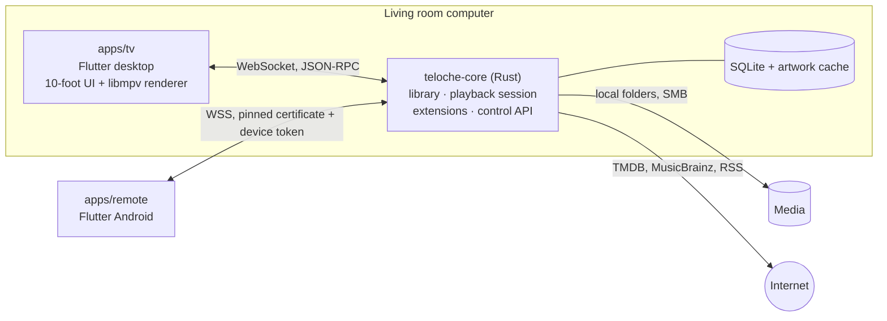

# Architecture

## Components



- **The core is a headless Rust process.** The TV app starts it as a sidecar; it also runs alone for
  development, tests and CI.
- **One API for every client.** The TV app is a client of the control API exactly like the remote. The
  API is therefore complete by construction, and every client shares the same Dart client
  (`packages/client`). See [ADR 0002](../adr/0002-rust-core-flutter-clients-single-api.md).
- **The renderer model.** The core owns the playback state (queue, current item, resume points). The TV
  app hosts the libmpv player and only executes commands (`load`, `seek`, `set_track`...) and reports
  events (position, end, errors, tracks). Playback logic is therefore testable without any UI.
- **Offline first.** SQLite and the local artwork cache are the source of truth; the network only
  enriches.

## Rust crates

Dependencies point inwards, towards `domain`, which has no I/O and no framework (hexagonal
architecture): adapters implement the ports (traits) the domain defines.

| Crate | Responsibility |
|---|---|
| `domain` | Entities, business rules, ports |
| `recognizer` | File name parsing (pure) |
| `vfs` | Local folders and network shares behind one trait |
| `library` | Full and incremental scans, enrichment pipeline |
| `metadata` | TMDB, MusicBrainz, RSS providers, cache, rate limiting |
| `storage` | SQLite migrations and repositories |
| `playback` | Playback session state machine |
| `extensions` | Extension host: manifests, permissions, sandbox, lifecycle |
| `api` | HTTP and WebSocket server, JSON-RPC dispatch, pairing, discovery |
| `protocol` | Wire contract types, source of truth for the generated schema |
| `core` | Composition root: configuration, wiring, binary |

## Control API

- `GET /health`: liveness probe.
- `GET /api/v1/ws`: WebSocket carrying [JSON-RPC 2.0](https://www.jsonrpc.org/specification).

```json
→ {"jsonrpc": "2.0", "id": 1, "method": "system.ping"}
← {"jsonrpc": "2.0", "id": 1, "result": {"server_version": "0.0.1", "api_version": "1"}}
```

The contract is defined once, in `crates/protocol`. `just codegen` exports it as JSON Schema to
`packages/protocol/schema/`, and CI fails if the committed schema is out of date.

## Dart packages

| Package | Responsibility |
|---|---|
| `packages/protocol` | Dart side of the contract |
| `packages/client` | JSON-RPC client over WebSocket |
| `packages/design_system` | Brand tokens and accessible components, shared by both apps |

All Dart packages form one [pub workspace](https://dart.dev/tools/pub/workspaces): a single
`flutter pub get` at the root and a single lockfile.
